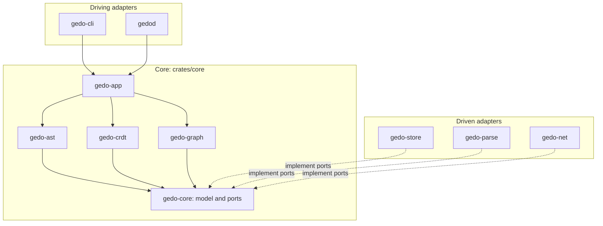

# gedo — Technical Documentation

Entry point to the architecture of gedo. This index is maintained with the
`architecture-docs` skill: the sections between `architecture-docs` markers are
generated by `build_index.py`; the rest is written by hand.

## System Overview

Gedo (Git Event-Driven Overlay) is a collaboration overlay built on Git's object
store. It follows the hexagonal style (ADR-0001): a pure core of five crates holds
the domain model, the identity, event and graph algorithms and the use cases;
adapters connect it to gitoxide, Tree-sitter, redb and the network; the `gedo` CLI
and the `gedod` daemon drive it.

A file save flows from `gedod` to the ingest use case: the parser port returns a
neutral syntax tree, `gedo-ast` matches it against the previous `BlobAstMap` and
emits semantic deltas, `gedo-crdt` turns them into events appended to the WAL.
`gedo publish` packs the WAL into an event tape and a canonical Git commit.

State lives in the Git object store under `refs/gedo/*` (shared through standard
`git push` and `git fetch`) and in `.git/gedo/` (local WAL and redb cache, never
pushed). Source files and `refs/heads/*` stay untouched.

## Subsystems

<!-- architecture-docs:subsystems:start -->
| Subsystem | Summary |
|---|---|
| [Core Model and Ports](docs/architecture/core.md) | Shared domain model and the ports every adapter implements. |
| [Developer Surfaces](docs/architecture/surfaces.md) | The gedo CLI, the gedod daemon and the use cases they call. |
| [Event Log and Convergence](docs/architecture/events.md) | Records semantic events and converges concurrent changes deterministically. |
| [Git Object Store Adapter](docs/architecture/store.md) | Persists Gedo data as commit chains in the Git object store, with a local WAL and redb cache. |
| [Node Identity](docs/architecture/identity.md) | Keeps a stable identity for each code entity across edits, renames and moves. |
| [Parsing Adapter](docs/architecture/parsing.md) | Turns source files into the core's neutral syntax model with Tree-sitter. |
| [Symbol Graph](docs/architecture/graph.md) | Dependencies between symbols, minimum-cut graft and contract checks. |
| [Transport Adapter](docs/architecture/net.md) | Carries events and intents between developers. |
<!-- architecture-docs:subsystems:end -->

## Architecture Decision Records

<!-- architecture-docs:adrs:start -->
| ADR | Title | Status | Version | Date |
|---|---|---|---|---|
| [ADR-0011](docs/adr/0011-gedo-references-as-commit-chains-with-a-separate-fetch-names.md) | Gedo references as commit chains with a separate fetch namespace | proposed | v0.1.0 | 2026-10-24 |
| [ADR-0010](docs/adr/0010-three-tiers-of-real-time-coordination-and-merge-queue-comple.md) | Three tiers of real-time coordination and merge queue complement | accepted | v0.1.0 | 2026-10-24 |
| [ADR-0009](docs/adr/0009-semantic-merge-driver-and-shadow-merge.md) | Semantic merge driver and shadow merge | accepted | v0.1.0 | 2026-10-24 |
| [ADR-0008](docs/adr/0008-gedo-data-robust-to-history-rewrites.md) | Gedo data robust to history rewrites | accepted | v0.1.0 | 2026-10-24 |
| [ADR-0007](docs/adr/0007-deterministic-node-identity-derived-from-history.md) | Deterministic node identity derived from history | accepted | v0.1.0 | 2026-10-24 |
| [ADR-0006](docs/adr/0006-git-command-pass-through-with-hook-based-augmentation.md) | Git command pass-through with hook-based augmentation | accepted | v0.1.0 | 2026-10-23 |
| [ADR-0005](docs/adr/0005-serverless-operation-with-git-remotes-as-the-only-transport.md) | Serverless operation with Git remotes as the only transport | accepted | v0.1.0 | 2026-10-23 |
| [ADR-0004](docs/adr/0004-redb-for-the-local-symbol-cache.md) | redb for the local symbol cache | accepted | v0.1.0 | 2026-10-23 |
| [ADR-0003](docs/adr/0003-git-object-store-as-the-canonical-datastore.md) | Git object store as the canonical datastore | accepted | v0.1.0 | 2026-10-23 |
| [ADR-0002](docs/adr/0002-rust-workspace-with-gitoxide-tree-sitter-blake3-and-postcard.md) | Rust workspace with gitoxide, Tree-sitter, BLAKE3 and Postcard | accepted | v0.1.0 | 2026-10-23 |
| [ADR-0001](docs/adr/0001-hexagonal-architecture-over-a-bottom-up-crate-stack.md) | Hexagonal architecture over a bottom-up crate stack | accepted | v0.1.0 | 2026-10-23 |
<!-- architecture-docs:adrs:end -->

## How to Update This Documentation

- **A subsystem changed** (behavior, structure, data): edit its page in `docs/architecture/` in place, replacing outdated text.
- **A decision with alternatives and trade-offs**: create an ADR with `new_adr.py` and link it from the subsystem page.
- **A decision that reverses or corrects another**: create a new ADR with `--supersedes` or `--amends`; never rewrite an accepted ADR.
- **A feature was removed**: remove it from the subsystem page; its ADRs stay as history.
- **A release**: nothing here; release notes live in the GitHub releases.
- Run `check_docs.py` before committing.
