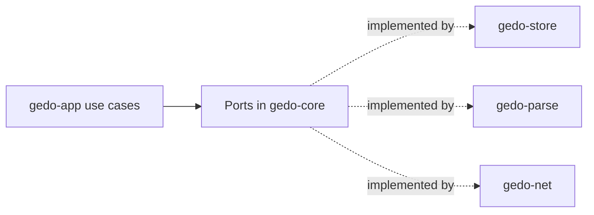

# Core Model and Ports

Shared domain model and the ports every adapter implements.

## Responsibilities

- Owns the types every other crate shares: object ids, node ids, the blob-to-node map, semantic deltas and events.
- Defines the **ports** (traits) through which the core reaches the outside world.
- Does not perform any I/O and depends on no adapter or infrastructure library (ADR-0001).

## Structure

| Type | Meaning |
|---|---|
| `GitOid` | Git object id, SHA-1 (20 bytes) or SHA-256 (32 bytes); `ObjectHash` names the kind |
| `EntryId` | Lowercase hex id of a collection entry (4 to 128 characters), split into a two-level fan-out |
| `GedoRefName` | A reference name checked to be under `refs/gedo/` |
| `RecordEnvelope` | A `u16` format version and a Postcard payload; every stored record is one |
| `StoreError` | The errors every store port returns: unsupported object format, contention, a busy WAL, corruption with an offset, unsupported record formats, size limits, I/O and backend failures |
| `ParsedFile` | What a parser returns for one file: `language`, `path`, every `Token` (`TokenClass` and `ByteRange`), every `RawEntity` (kind, qualified path, occurrence, container, `TokenRange`, body start) and `has_error` |
| `SyntaxMap` | The normalized file: `hash_format` and its `CodeEntity`s, each with kind, qualified path, occurrence, byte range, container, `has_error`, normalized signature and body tokens, and signature, body and structural hashes (`StructuralHash`) |
| `EntityKind` | Language-neutral entity category: module, function, method, struct, enum, union, trait, impl, constant, static, type alias, associated constant and type, macro, and import (internal to normalization) |
| `ParseError` | Unsupported language, file too large, tree too deep, timeout, internal error; syntax errors are never an error |
| `AstNodeId` | 16-byte UUID (v7 for new nodes) that identifies a code entity for its whole life |
| `BlobAstMap` | For one blob: `source_blob_oid`, `language` and its `AnchoredAstNode`s |
| `AnchoredAstNode` | `node_id`, `kind` (`function_item`, `struct_item`, ...), `qualified_path` (`crate::billing::Invoice::total`), `byte_range` (`u32`, `u32`) and `structural_hash` (`[u8; 32]`, BLAKE3) |
| `SemanticDelta` | `NodeCreated`, `NodeMoved`, `NodeRenamed`, `SignatureMutated`, `BodyModified`, `NodeTombstoned` |
| `Event` | `event_id`, `lamport_clock`, `target_node_id`, `operation` (`SemanticOp`: Insert, Delete, Move, Rename, PatchBody), `author_fingerprint` |

## Behavior

Ports, each with a real adapter and an in-memory adapter for tests:

| Port | Purpose | Real adapter |
|---|---|---|
| `ObjectStore` | Read and write blobs, trees and commits by `GitOid`; never moves a reference | `gedo-store` (gitoxide) |
| `RefStore` | Read and list `refs/gedo/*` and `refs/gedo-remote/*`, compare-and-swap and delete | `gedo-store` |
| `WriteAheadLog` | Append local micro-events, durable within 100 ms; read and truncate them | `gedo-store` (`.git/gedo/wal.log`) |
| `SymbolCache` | Fast lookups by namespace and key; rebuilt from a `CacheRebuildSource` | `gedo-store` (redb) |
| `Parser` | Source bytes of a file into a `ParsedFile`; detects the language from the path | `gedo-parse` (Tree-sitter) |
| Clock | Wall-clock time for ids and logs | standard library, later |
| Transport | Exchange tapes and intents with other developers | `gedo-net`, later |

`Collection` is the core's logic over the object and reference ports: one commit chain per collection with a two-level fan-out tree, `put` with a compare-and-swap retry loop (8 attempts, then `Contended`), `merge_remote` that fast-forwards or merges the chain fetched from a remote, and `union` of two entry sets, which is commutative, associative and idempotent. It runs unchanged on the in-memory and the gitoxide adapters.

The `memory` feature provides the in-memory adapters (`MemoryObjectStore`, `MemoryRefStore`, `MemoryWal`, `MemoryCache`, and `FixedParser`, which returns prepared `ParsedFile`s), with hooks to simulate a crash, the end of the durability window or a repository without identity. The `contract-tests` feature provides one contract suite per port and for `Collection`, as macros that every adapter's tests instantiate, so the in-memory and the real adapters are held to the same behavior.

## Interfaces

Used by every crate. Calls nothing.

## Decisions

- [ADR-0001](../adr/0001-hexagonal-architecture-over-a-bottom-up-crate-stack.md): hexagonal architecture; ports live here.
- [ADR-0002](../adr/0002-rust-workspace-with-gitoxide-tree-sitter-blake3-and-postcard.md): BLAKE3 hashes, Postcard serialization, UUID v7 ids.
