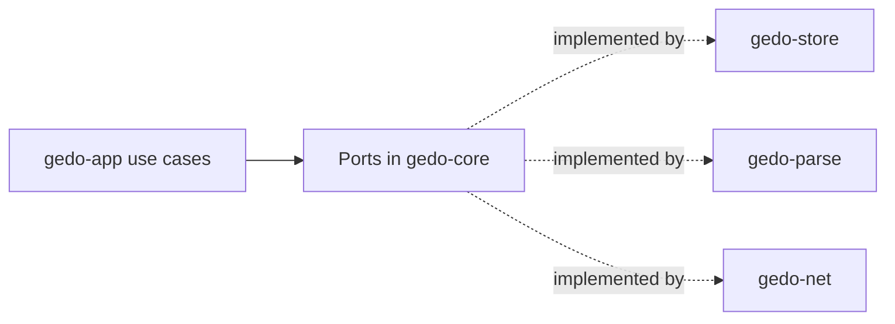

# Core Model and Ports

Shared domain model and the ports every adapter implements.

## Responsibilities

- Owns the types every other crate shares: object ids, node ids, the blob-to-node map, semantic deltas and events.
- Defines the **ports** (traits) through which the core reaches the outside world.
- Does not perform any I/O and depends on no adapter or infrastructure library (ADR-0001).

## Structure

| Type | Meaning |
|---|---|
| `GitOid` | Git object id, SHA-1 (20 bytes) or SHA-256 (32 bytes) |
| `AstNodeId` | 16-byte UUID (v7 for new nodes) that identifies a code entity for its whole life |
| `BlobAstMap` | For one blob: `source_blob_oid`, `language` and its `AnchoredAstNode`s |
| `AnchoredAstNode` | `node_id`, `kind` (`function_item`, `struct_item`, ...), `qualified_path` (`crate::billing::Invoice::total`), `byte_range` (`u32`, `u32`) and `structural_hash` (`[u8; 32]`, BLAKE3) |
| `SemanticDelta` | `NodeCreated`, `NodeMoved`, `NodeRenamed`, `SignatureMutated`, `BodyModified`, `NodeTombstoned` |
| `Event` | `event_id`, `lamport_clock`, `target_node_id`, `operation` (`SemanticOp`: Insert, Delete, Move, Rename, PatchBody), `author_fingerprint` |

## Behavior

Ports, each with a real adapter and an in-memory adapter for tests:

| Port | Purpose | Real adapter |
|---|---|---|
| Object store | Read and write blobs and trees by `GitOid` | `gedo-store` (gitoxide) |
| Reference store | Read, list and compare-and-swap references under `refs/gedo/*` | `gedo-store` |
| Write-ahead log | Append and read local micro-events | `gedo-store` (`.git/gedo/wal.log`) |
| Symbol cache | Fast lookups by path, node id and blob | `gedo-store` (redb) |
| Parser | Source bytes and language into a neutral syntax tree | `gedo-parse` (Tree-sitter) |
| Clock | Wall-clock time for ids and logs | standard library |
| Transport | Exchange tapes and intents with other developers | `gedo-net` |

## Interfaces

Used by every crate. Calls nothing.

## Decisions

- [ADR-0001](../adr/0001-hexagonal-architecture-over-a-bottom-up-crate-stack.md): hexagonal architecture; ports live here.
- [ADR-0002](../adr/0002-rust-workspace-with-gitoxide-tree-sitter-blake3-and-postcard.md): BLAKE3 hashes, Postcard serialization, UUID v7 ids.
