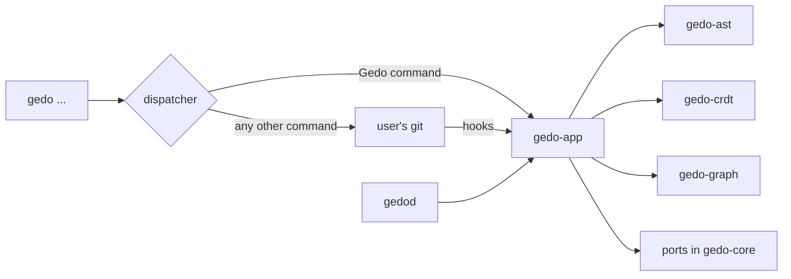

# Developer Surfaces

The gedo CLI, the gedod daemon and the use cases they call.

## Responsibilities

- `gedo-app` (core): one use case per user action: `init`, ingest a file change, `publish`, `trace`, `graft`, `delta`, `radar`, `stream`, `doctor`, merge a file (merge driver), shadow merge, sync after a Git event (commit, checkout, merge, rewrite, push), and later `inbox`, `accept`, `peek`, `playback`, `recover`, `undo`.
- `gedo-cli`: the `gedo` binary; dispatches each invocation to a use case or passes it through to Git, and renders results.
- `gedod`: the background daemon; watches the file system, and on each save calls the ingest use case (parse, identity, WAL); fetches the tracked remote branches in the background and runs the shadow merge.
- A GitHub Action (after the MVP): semantic diff and contract checks on pull requests, re-attachment after server-side merges, merge queue checks.
- Git hooks installed by `gedo init`: call the sync use case so the overlay stays correct when `git` is used directly.
- Each binary has one composition root that builds the adapters and wires them into the use cases. No surface keeps rules of its own.

## Structure

## Behavior

**Gedo commands**

| Command | Use case |
|---|---|
| `gedo init` | Prepare `.git/gedo/`, write the `refs/gedo/*` refspecs, install and chain the hooks, build the first AST maps |
| `gedo publish [--split-lanes]` | Pack the WAL into canonical tapes and create the native Git commit; with `--split-lanes`, a refactor commit followed by a feature commit |
| `gedo delta` | Semantic diff: moved, renamed, refactored or changed |
| `gedo stream <name>` | Switch to or create a virtual stream in memory |
| `gedo radar` | Collisions found by the shadow merge and overlay state |
| `gedo doctor` | Diagnostics: versions, paths, hook chain, merge driver, overlay consistency |
| `gedo merge-driver` | Called by Git for each file to merge; not typed by users |
| `gedo trace <symbol>` | Semantic history per entity, not per line |
| `gedo graft <symbol-path> --into <target-stream>` | Move a symbol and its minimal dependencies into another stream |
| `gedo inbox`, `gedo accept <proposal>` | After the MVP: asynchronous negotiation per symbol |
| `gedo peek @dev <symbol>` | After the MVP: a colleague's work in progress on a symbol (relay tier) |
| `gedo playback <commit>` | After the MVP: event-by-event evolution of a delivery |
| `gedo recover`, `gedo undo` | After the MVP: restore saved states from the WAL; undo the last operations |

`gedo init` and `gedo gc` share their names with Git, so they keep Git's behavior: they run `git init` or `git gc` first, unchanged, and then set up or prune the overlay.

**Git commands**: any other invocation, including unknown commands and the user's aliases, runs the user's `git` with the same arguments, inherited standard input, output and error, and the same exit code. A command with a Git name always keeps Git's behavior and output.

**Hooks**: `post-commit`, `post-checkout`, `post-merge`, `post-rewrite`, `pre-push` and `reference-transaction` call `gedo` to sync the overlay. Hooks that existed before (in `.git/hooks`, a custom `core.hooksPath`, or from Husky, lefthook or pre-commit) are chained in their original order and their exit codes are respected.

A language server and VS Code extension are later driving adapters over the same use cases.

## Interfaces

- `gedo-app` calls the identity, events and graph crates and the ports of `gedo-core`.
- The binaries call only `gedo-app`, the adapter constructors and, for pass-through, the user's `git`.

## Decisions

- [ADR-0001](../adr/0001-hexagonal-architecture-over-a-bottom-up-crate-stack.md): surface parity over one canonical state.
- [ADR-0006](../adr/0006-git-command-pass-through-with-hook-based-augmentation.md): Git pass-through, hook-based augmentation and `gedo trace`.
- [ADR-0009](../adr/0009-semantic-merge-driver-and-shadow-merge.md): merge driver, shadow merge and background fetch.
- [ADR-0010](../adr/0010-three-tiers-of-real-time-coordination-and-merge-queue-comple.md): hosting integration and merge queue complement.
