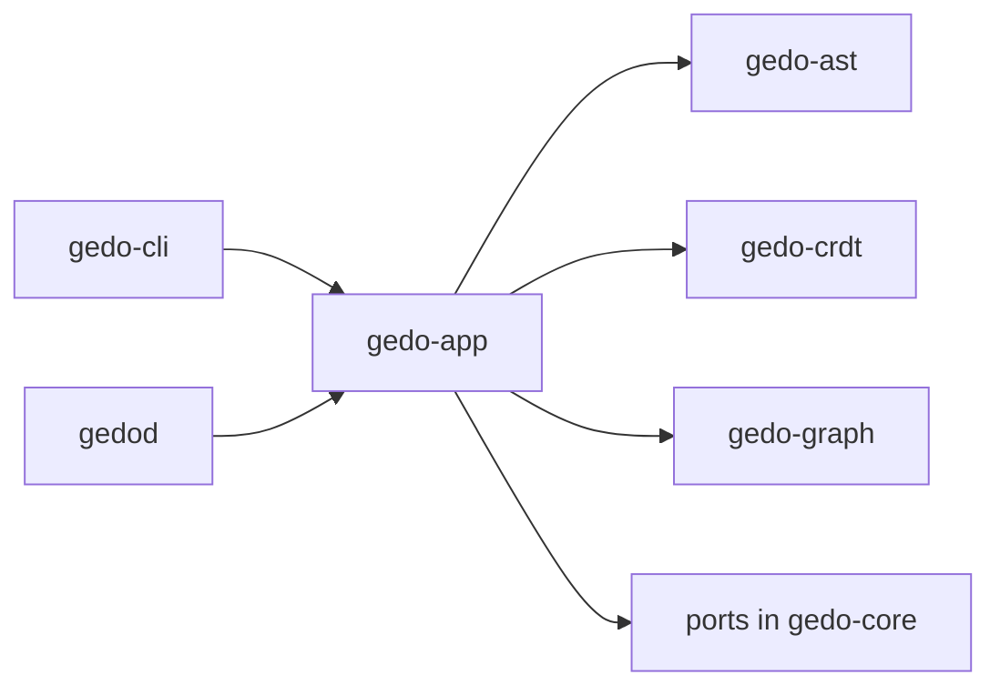

# Developer Surfaces

The gedo CLI, the gedod daemon and the use cases they call.

## Responsibilities

- `gedo-app` (core): one use case per user action: `init`, ingest a file change, `publish`, `blame`, `graft`, `status`, and later `inbox`.
- `gedo-cli`: the `gedo` binary; parses arguments, calls a use case and renders its result.
- `gedod`: the background daemon; watches the file system, and on each save calls the ingest use case (parse, identity, WAL).
- Each binary has one composition root that builds the adapters and wires them into the use cases. No surface keeps rules of its own.

## Structure

## Behavior

| Command | Use case |
|---|---|
| `gedo init` | Prepare `.git/gedo/`, write the `refs/gedo/*` refspecs, build the first AST maps |
| `gedo publish` | Pack the WAL into canonical tapes and create the native Git commit |
| `gedo blame <symbol>` | Semantic history per entity, not per line |
| `gedo graft <symbol-path> --into <target-stream>` | Move a symbol and its minimal dependencies into another stream |
| `gedo inbox` | After the MVP: asynchronous negotiation and review per symbol |

A language server and VS Code extension are later driving adapters over the same use cases.

## Interfaces

- `gedo-app` calls the identity, events and graph crates and the ports of `gedo-core`.
- The binaries call only `gedo-app` and the adapter constructors.

## Decisions

- [ADR-0001](../adr/0001-hexagonal-architecture-over-a-bottom-up-crate-stack.md): surface parity over one canonical state.
